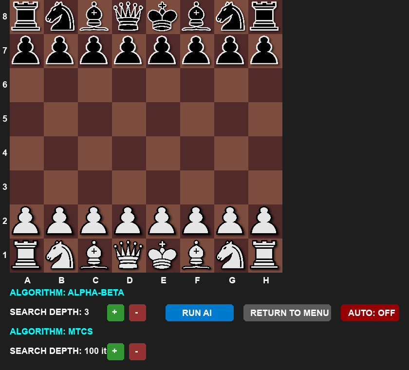

# Chess Engine

A Python chess simulator for exploring two game-playing approaches: **Alpha-Beta pruning** and **Monte Carlo Tree Search (MCTS)**. Watch the agents play on a graphical chessboard, compare algorithm matchups, and tune search depth or simulation count.



## What it does

- Runs Alpha-Beta vs Alpha-Beta, MCTS vs MCTS, or either mixed matchup.
- Offers standard and custom board setups.
- Lets you step through AI moves or enable autoplay.
- Lets you adjust Alpha-Beta search depth and MCTS iteration count.

## Example result

On the standard starting board, an Alpha-Beta search at depth 2 selected **b1c3 (Nc3)**, returned an evaluation of **0**, and searched **222 nodes**. This is one opening-search result, not a match outcome or a performance comparison.

## Run locally

Requires Python 3 and the `pygame-ce` dependency.

```shell
git clone https://github.com/Zubereus/chessEngine.git
cd chessEngine
python -m venv .venv
```

Activate the virtual environment:

```powershell
# Windows PowerShell
.venv\Scripts\Activate.ps1
```

```shell
# macOS / Linux
source .venv/bin/activate
```

Install the dependency and start the app:

```shell
python -m pip install -r requirements.txt
python main.py
```

In the configuration window, choose a board mode and AI matchup, set the search parameters, and start the game. In the game window, use **RUN AI** to advance one move or **AUTO** to let the agents play continuously.

## Algorithms

- **Alpha-Beta pruning** searches game-tree positions to a configurable depth.
- **MCTS** uses a configurable number of iterations to select moves.
- **Mixed matchups** let you observe the two approaches playing against each other.
