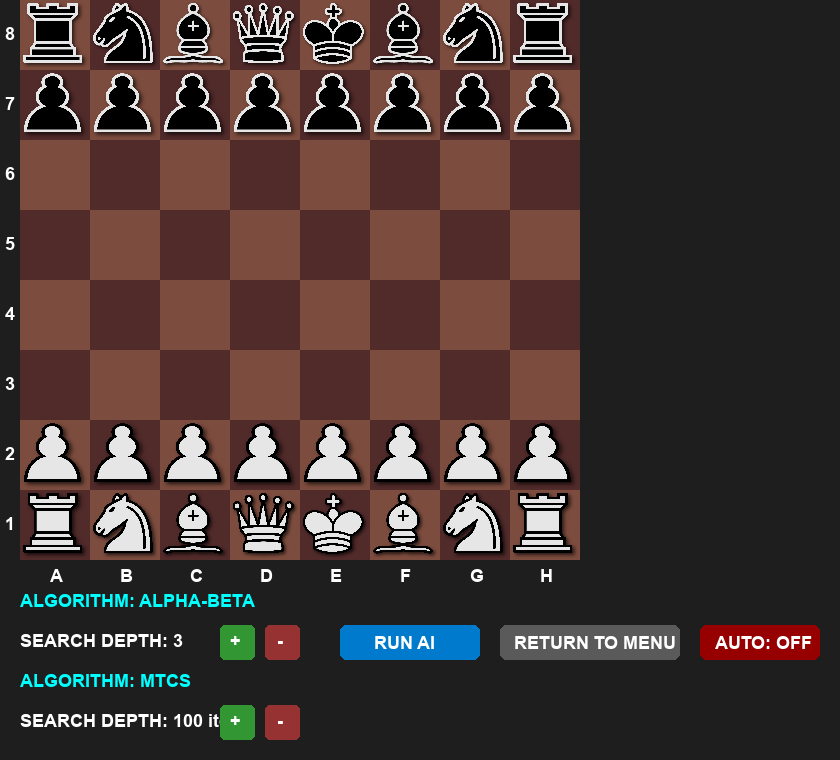

# Chess Engine

A Python chess simulator for playing against custom **Alpha-Beta pruning** or **Monte Carlo Tree Search (MCTS)** agents, or watching the agents play each other.



## What it does

- Play Human vs AI (you play White) with either Alpha-Beta or MCTS, or choose AI vs AI matchups.
- Use standard or custom board setups.
- Set an alternating clock from 1 to 180 minutes per side (10 minutes by default).
- Step through AI moves or enable autoplay in AI vs AI games.
- Adjust Alpha-Beta search depth and MCTS iteration count during a game.

## Example result

On the standard starting board, an Alpha-Beta search at depth 2 selected **b1c3 (Nc3)**, returned an evaluation of **0**, and searched **222 nodes**. This is one opening-search result, not a match outcome or a performance comparison.

## Run locally

Requires Python 3 and the `pygame-ce` dependency.

```shell
git clone https://github.com/Zubereus/chessEngine.git
cd chessEngine
python -m venv .venv
```

Activate the virtual environment:

```powershell
# Windows PowerShell
.venv\Scripts\Activate.ps1
```

```shell
# macOS / Linux
source .venv/bin/activate
```

Install the dependency and start the app:

```shell
python -m pip install -r requirements.txt
python main.py
```

The repository includes the chess-piece and board images in `assets/chess_img/`; keep that folder alongside the source when downloading or packaging the project. The tested Pygame Community Edition version is pinned in `requirements.txt`.

In the configuration window, choose a board mode and game mode, select Alpha-Beta or MCTS for the AI, set the clock and search parameters, and start the game. Press **F11** to toggle fullscreen from either window. In Human vs AI, select one of your White pieces and then a highlighted legal destination; **RUN AI** advances the Black AI. In AI vs AI, use **RUN AI** to advance one move or **AUTO** to let the agents play continuously.

## Algorithms

- **Alpha-Beta pruning** searches game-tree positions to a configurable depth.
- **MCTS** uses a configurable number of iterations, capture-aware move ordering, and short evaluated rollouts to keep move time practical.
- **Mixed matchups** let you observe the two approaches playing against each other.

These are educational custom engines, not Stockfish, and their playing strength is not expected to match Stockfish.

## Play online

Live URL: _Add the deployed Vercel URL here._

## Run the web version locally

Install the Vercel CLI, then run the project from its root:

```shell
npm install --global vercel
vercel dev
```

Open the URL printed by `vercel dev`.

## How the web version works

The browser keeps the starting position and the full move list. Each API request replays those moves on a fresh board, so the server does not keep game state between requests.

## Limits of the web version

- Alpha-Beta depth is limited to 8.
- MCTS is limited to 500 iterations per move.
- Alpha-Beta stops after 4 seconds and returns the best move from its deepest completed search. The Vercel function limit is 10 seconds, leaving time for replaying moves and building the response.
- The API uses Python's standard library and the existing Python engine; it does not need `pygame-ce`.

## Deploy to Vercel

The web version is deployed from the `web` branch. The `main` branch remains the desktop version and is never changed or used for the production deployment. Vercel normally creates Preview deployments for other branches, including `main`. To prevent any deployment from `main`, open **Project Settings → Build and Deployment → Ignored Build Step**, choose **Custom**, and use:

```shell
if [ "$VERCEL_GIT_COMMIT_REF" = "main" ]; then exit 0; else exit 1; fi
```

Vercel skips the build when that command returns `0` and continues when it returns `1`.

1. Review and commit the web changes on the current feature branch, never on `main`.
2. From that feature branch, create `web` and push it:

   ```shell
   git switch <current-feature-branch>
   git switch -c web
   git push --set-upstream origin web
   ```

   If `web` already exists, update it with the reviewed feature branch changes instead of creating a second branch.
3. In Vercel, choose **Import Project** and select this GitHub repository. Set the framework preset to **Other**, leave the build command empty, and keep the root directory at the repository root.
4. After importing, open **Project Settings → Environments → Production → Branch Tracking**, set the production branch to `web`, and save. This is the current location in Vercel's [Git deployment settings](https://vercel.com/docs/git#production-branch).
5. Keep `main` as the repository's desktop-only default branch. With `web` selected as Production Branch, pushes to `web` create production deployments; other branches are normally preview deployments.

You can instead leave `main` as the Production Branch and use Preview deployments from `web` for testing. Vercel Deployment Protection may require visitors to log in to preview URLs, so check its [protection settings](https://vercel.com/docs/deployment-protection) before sharing a preview publicly.

On the first build, confirm the runtime line reports Python 3.14 and the dependency resolution/install output does not include `pygame-ce`. Vercel supports Python 3.14, and this repository's `.python-version` selects it. The exact dependency log wording can vary; the build log must show that `pygame-ce` was not installed.

Check the deployed API with these requests, replacing the hostname with the Vercel deployment URL:

```shell
curl https://<deployment-host>/api/health
curl -X POST https://<deployment-host>/api/new-game -H "Content-Type: application/json" -d '{"start_position":{"type":"standard"}}'
```

If a build or function fails, check these first:

1. Dependency resolution found the desktop `requirements.txt`: confirm the Vercel build honored `.vercelignore` and did not install `pygame-ce`.
2. An engine import is missing from the function bundle: confirm the function includes `src/**` and excludes only desktop-only modules.
3. An AI request exceeded the function duration: lower the requested depth or MCTS iterations, then check the function logs and the configured 10-second duration.

## Run the tests

Run the Python suite and the browser logic checks from the repository root:

```shell
python -m unittest discover tests
node tests/test_web_logic.mjs
```
