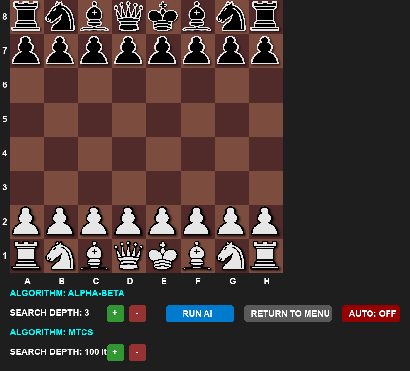

# Chess Engine

A Python chess simulator for playing against custom **Alpha-Beta pruning** or **Monte Carlo Tree Search (MCTS)** agents, or watching the agents play each other.



## What it does

- Play Human vs AI (you play White) with either Alpha-Beta or MCTS, or choose AI vs AI matchups.
- Use standard or custom board setups.
- Set an alternating clock from 1 to 180 minutes per side (10 minutes by default).
- Step through AI moves or enable autoplay in AI vs AI games.
- Adjust Alpha-Beta search depth and MCTS iteration count during a game.

## Example result

On the standard starting board, an Alpha-Beta search at depth 2 selected **b1c3 (Nc3)**, returned an evaluation of **0**, and searched **222 nodes**. This is one opening-search result, not a match outcome or a performance comparison.

## Run locally

Requires Python 3 and the `pygame-ce` dependency.

```shell
git clone https://github.com/Zubereus/chessEngine.git
cd chessEngine
python -m venv .venv
```

Activate the virtual environment:

```powershell
# Windows PowerShell
.venv\Scripts\Activate.ps1
```

```shell
# macOS / Linux
source .venv/bin/activate
```

Install the dependency and start the app:

```shell
python -m pip install -r requirements.txt
python main.py
```

The repository includes the chess-piece and board images in `assets/chess_img/`; keep that folder alongside the source when downloading or packaging the project. The tested Pygame Community Edition version is pinned in `requirements.txt`.

In the configuration window, choose a board mode and game mode, select Alpha-Beta or MCTS for the AI, set the clock and search parameters, and start the game. Press **F11** to toggle fullscreen from either window. In Human vs AI, select one of your White pieces and then a highlighted legal destination; **RUN AI** advances the Black AI. In AI vs AI, use **RUN AI** to advance one move or **AUTO** to let the agents play continuously.

## Algorithms

- **Alpha-Beta pruning** searches game-tree positions to a configurable depth.
- **MCTS** uses a configurable number of iterations, capture-aware move ordering, and short evaluated rollouts to keep move time practical.
- **Mixed matchups** let you observe the two approaches playing against each other.

These are educational custom engines, not Stockfish, and their playing strength is not expected to match Stockfish.
